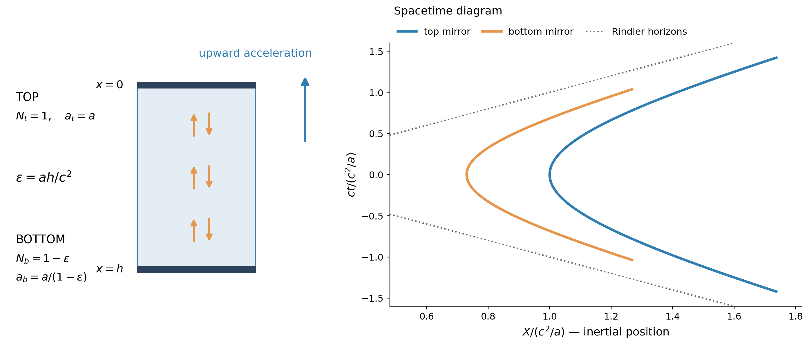
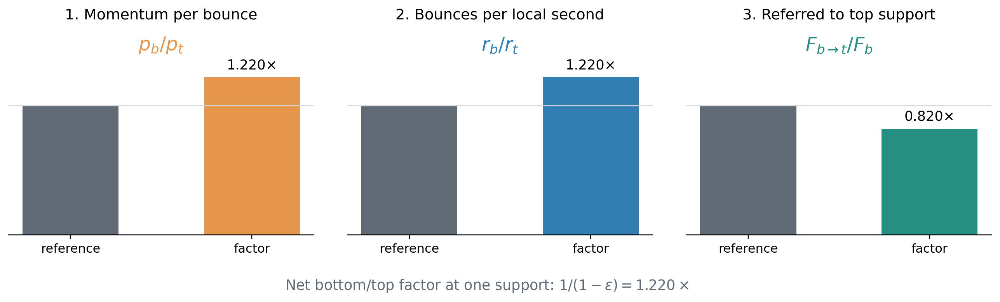
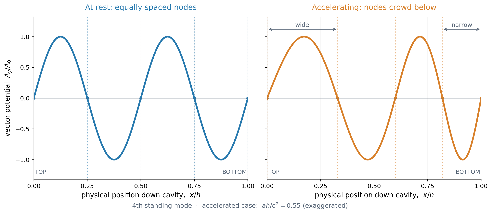
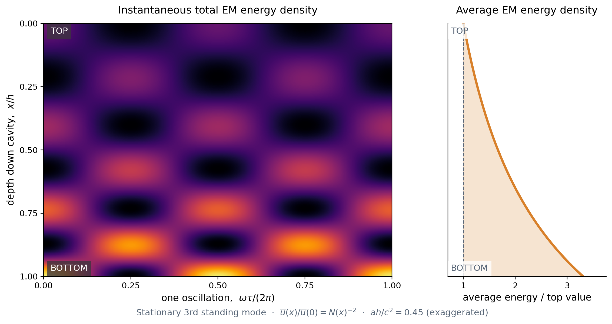

<!--
POST — MEDIUM PUBLISHING METADATA (not article prose)
Status: GATE B — REVISED HUMAN REVIEW / not published
Revision: 2026-11-20 — copy-edit pass: Unicode subscripts, notation consistency, photon-result exactness, citations, metadata/image alignment
Medium title: Light Is Heavy
Medium subtitle: Why light in an accelerating cavity pushes harder on the lower mirror — and why classical electromagnetism already knows the answer
Medium topics (choose up to five):
  - Physics
  - Special Relativity
  - Electromagnetism
  - Quantum Physics
  - Thought Experiments
SEO title: Why Light in an Accelerating Box Has Weight
SEO description: Confine light between mirrors, accelerate the box, and discover why its energy contributes weight — without needing a photon model.
Suggested preview title: Light Is Heavy
Suggested preview subtitle: A box of light, two clocks, and an unexpectedly classical answer
Publication: Science Spectrum (select at publishing time, if approved)
Canonical URL: [leave blank unless an earlier original is the canonical source]
Featured image: post1_feature_modepattern.png
Featured-image caption: A standing wave in an accelerating cavity, compressed toward the bottom. Conceptual illustration, not a computed field map. Image by author.
Featured-image alt text: A dark-background illustration showing eight glowing bands of a standing electromagnetic wave between two horizontal mirrors. The bands become progressively closer together and brighter toward the bottom, changing from purple to orange and yellow.
Suggested excerpt: Light has no invariant mass, yet a box containing light is harder to accelerate. When we follow the reflections between two accelerating mirrors, the lower mirror feels a stronger local push. Comparing the forces correctly leads to the familiar E/c². More surprisingly, a classical Maxwell standing wave produces the same effect, with no photons required.
-->

# Light Is Heavy
## Why light in an accelerating cavity pushes harder on the lower mirror — and why classical electromagnetism already knows the answer

> Caption: A standing wave in an accelerating cavity, compressed toward the bottom. Conceptual illustration, not a computed field map.
> Alt text: A dark-background illustration showing eight glowing bands of a standing electromagnetic wave between two horizontal mirrors. The bands become progressively closer together and brighter toward the bottom, changing from purple to orange and yellow.
> Source: Image by author.

## Light in a Box Is No Longer Weightless

A freely travelling photon has zero invariant mass; we are used to saying that light is weightless. At the same time, a beam of light can push on a mirror, and the mirror recoils. What happens to the weight of a box if we fill it with light?

Einstein's famous formula suggests an answer: adding energy *E* to a closed system increases its inertial mass by *E*/*c*². The energy contributes to the mass of the complete box-and-light system. Van der Mark and 't Hooft, working at Philips Research in the Netherlands, used this box-of-light argument in Light is Heavy [1]. They were not trying to overturn Einstein's formula. They wanted to see how it works.

## Acceleration Makes the Two Mirrors Unequal

For a box at rest, or moving at constant velocity far from gravitating bodies, light bouncing between two opposite mirrors exerts equal and opposite average forces. There is no net push on the box.

An accelerating box is not quite the same. In relativity, we must first say whose clocks and rulers we use. We want the two mirrors to maintain the same separation in the instantaneous frame moving with the box. This is called Born-rigid motion. It requires the lower mirror to have a slightly larger proper acceleration than the upper one [2,3].

We assume that the box accelerates through otherwise flat spacetime. We use Rindler coordinates, which move with the mirrors. Let *x* measure distance downward from the upper mirror: the top is at *x* = 0 and the bottom at *x* = *h*. Let *a* be the proper acceleration of the top mirror and τ the time recorded by its clock.

The spacetime interval between nearby events is then

$$
ds^2=-N(x)^2c^2d\tau^2+dx^2,
\qquad N(x)=1-\frac{ax}{c^2}.
$$

This is still flat spacetime: Rindler coordinates describe accelerated observers, not spacetime curvature. We require the dimensionless quantity ε = *ah*/*c*² to be less than one. This keeps both mirrors within the same Rindler region, where light can travel between them.

> A clock at the bottom mirror runs slower, and the mirror accelerates harder, than at the top. This is a consequence of describing the cavity as one rigid, accelerating box.

The quantity *N*(*x*) tells us how the local clocks compare at different positions in the cavity. During the same interval of top-clock time, a clock at the bottom records slightly less elapsed time.

$$
d\tau_{\mathrm{bottom}}=(1-\varepsilon)\,d\tau_{\mathrm{top}},
\qquad \varepsilon\equiv\frac{ah}{c^2}.
$$

The proper acceleration at position *x* is *a*/*N*(*x*), so the lower mirror accelerates slightly more strongly.

> Caption: Figure 1. A Born-rigid box accelerating upward. Left: light travels both upward and downward between two mirrors that maintain a fixed proper separation. Right: an inertial spacetime diagram shows the two mirror worldlines as different hyperbolae, drawn over the same interval of top-clock time, and the past and future Rindler horizons as dotted lines. The lower mirror has the larger proper acceleration. ε = 0.27 is exaggerated for clarity. Image by author.
> Alt text: Left, an upright cavity with arrows showing light travelling both upward and downward, and labels for the unequal accelerations and ε = ah/c². Right, a spacetime diagram with a blue hyperbola for the top mirror, an orange hyperbola for the bottom mirror, and two dotted diagonal Rindler horizons. There are no light paths or constant-Rindler-time guide lines in the spacetime panel.

Now imagine a photon bouncing up and down between the mirrors. Each impact causes a recoil. We want the net force exerted on the box, measured with respect to one observer, and the energy that observer assigns to the light. We need to know how hard the photon kicks each mirror and how often the kicks arrive. The metric gives us both the travel time and the relation between the two clocks.

A light ray has *ds*² = 0, so its travel time over a small distance *dx*, measured by the top clock, obeys

$$
d\tau=\frac{|dx|}{cN(x)}.
$$

Going from top to bottom therefore takes, in top-clock time,

$$
T=-\frac{c}{a}\ln(1-\varepsilon).
$$

Because the metric is stationary, the return trip takes the same top-clock time. The photon therefore hits either mirror once every 2*T*, as measured by the top clock.

## The Lower Mirror Gets Hit Harder

Let *E*ₜ denote the energy of the photon measured locally at the top mirror. Each reflection reverses its momentum, so the top mirror receives an upward impulse Δ*p*ₜ = 2*E*ₜ/*c*. The photon returns to the top every 2*T*. Thus the average force there is

$$
F_{\mathrm{top}}^{\mathrm{local}}=\frac{2E_t/c}{2T}=\frac{E_t}{cT}.
$$

The photon gains locally measured energy as it travels downward. This is the accelerating-frame version of gravitational blueshift. The energy read by a nearby observer at position *x* is

$$
E_{\mathrm{local}}(x)=\frac{E_t}{N(x)}.
$$

At the bottom mirror this is *E*ₜ/(1 − ε).

Two local factors change the force. First, each impact on the bottom mirror transfers 1/(1 − ε) times as much local momentum as an impact at the top.

Second, the bottom clock runs more slowly. The same series of bounces arrives at a rate 1/(1 − ε) times higher per bottom-clock second.

$$
\frac{F_{\mathrm{bottom}}^{\mathrm{local}}}{F_{\mathrm{top}}^{\mathrm{local}}}
=\frac{1}{(1-\varepsilon)^2}.
$$

So a local observer attached to the bottom mirror registers a larger force.

It might seem natural to subtract the two local force readings. But they are made at different locations, using clocks that run at different rates. To find the force on a single support, we must refer both readings to that support.

That gives the third factor. Suppose the cavity is supported at its top. A stationary mechanical connection transmits the lower force upward with a factor 1 − ε [3]. The bottom force must therefore be multiplied by 1 − ε before we compare it with the top force.

$$
\frac{F_{\mathrm{bottom}}^{\mathrm{top\ referred}}}{F_{\mathrm{top}}^{\mathrm{local}}}=\frac{1}{1-\varepsilon}.
$$

A single support at the top does not simply subtract readings made with two different clocks. Figure 2 keeps the three factors separate.

> Caption: Figure 2. Three factors change the comparison between the top and bottom mirror forces. The momentum per reflection and the number of reflections per local second each grow by 1/(1 − ε). Transmitting the lower force to the top support contributes a factor 1 − ε. Their product is 1/(1 − ε), shown beneath the charts. The example uses ε = 0.18, exaggerated for visibility. Image by author.
> Alt text: Three bar charts compare a reference of one with the factors for local momentum per bounce, local bounce rate and force transmitted to the top support. The first two factors are 1.220, the third is 0.820, and the net top-referred bottom-to-top factor is 1.220.

Each reflection at the top transfers 2*E*ₜ/*c* upward to the mirror. Each reflection at the bottom transfers 2*E*ₜ/[*c*(1 − ε)] downward when referred to the top. Averaging over one full round trip, the net force exerted by the light on the box, referred to the top support and with upward positive, is

$$
F_{\mathrm{light}}
=\frac{2E_t/c}{2T}
-\frac{2E_t/[c(1-\varepsilon)]}{2T}
=-\frac{E_t}{cT}\frac{\varepsilon}{1-\varepsilon}.
$$

For a cavity small compared with *c*²/*a*, we have ε ≪ 1 and *T* ≈ *h*/*c*. Therefore

$$
F_{\mathrm{light}}\simeq-\frac{E_t a}{c^2}.
$$

The extra force needed to accelerate the box has magnitude *m* *a*, where *m* is the light's contribution to the box's inertia. To leading order, we recover Einstein's famous formula:

$$
m_{\mathrm{light}}=\frac{E_t}{c^2}.
$$

The only approximation here is using *E*ₜ for the light's energy. We can remove it. The photon spends a top-clock time *dx*/(*cN*) in each slice *dx*, out of *T* per one-way trip, and there carries local energy *E*ₜ/*N*. Its time-averaged, locally measured energy is therefore

$$
\langle E\rangle=\int_0^h\frac{E_t}{N(x)}\,\frac{dx}{cN(x)\,T}
=\frac{E_t}{cT}\,\frac{c^2}{a}\,\frac{\varepsilon}{1-\varepsilon},
$$

and the exact force we found above is simply −*a*⟨*E*⟩/*c*². Notice the weighting: one factor 1/*N* from the blueshift and one from the time the photon lingers lower down, so the photon's average energy is distributed as 1/*N*². We will meet that profile again. This shows why confined light adds energy divided by *c*² to the inertia of the complete box, as Van der Mark and 't Hooft explained [1].

The walls also carry mechanical stress, which matters for the inertia of the closed box-and-light system [4,5]. Once we treat that complete system consistently, its additional mass is the added energy divided by *c*².

## Now Remove the Photon

So far, we have followed the light as a particle bouncing between mirrors. That was convenient, but was it necessary?

Now replace the photon with a classical electromagnetic standing wave. The cavity is again accelerating upward, and the mirrors stay at fixed positions in the coordinates we have chosen. Light cannot simply have the same standing-wave shape as in an inertial box: the lower part of the cavity measures time differently.

The trick is to measure distances by the time light takes to cross them. Define the optical coordinate

$$
\xi(x)=\int_0^x\frac{dx'}{N(x')}
=-\frac{c^2}{a}\ln N(x).
$$

Written in the physical distance *x*, Maxwell's equation for a wave travelling straight up and down picks up extra factors of *N*. Written in ξ and τ, it becomes the ordinary one-dimensional wave equation again. A standing-wave solution for the transverse vector potential *A* (pointing horizontally, along the mirrors) is simply

$$
A(x,\tau)=A_0\sin\!\big[k\xi(x)\big]\cos(\omega\tau),
\qquad \omega=ck.
$$

We choose the wave number so that *k*ξ(*h*) is an integer multiple of π, placing nodes at both mirrors. There is nothing unusual about a sine wave in optical distance. What looks unusual is that, when we draw it against the ruler distance *x*, the wave is skewed. Because one unit of physical distance corresponds to progressively more optical distance toward the bottom, successive nodes become closer together in physical space. The wave is squeezed toward the bottom.

> Caption: Figure 3. The fourth standing-wave mode in a cavity at rest (left) and an accelerating cavity (right), plotted against physical distance. Nodes equally spaced in optical coordinate ξ crowd toward the bottom when viewed against *x*. The example uses ε = 0.55 to make the skew visible. The curves show the vector potential, not the electromagnetic energy density. Image by author.
> Alt text: Two side-by-side plots show an ordinary standing-wave sine curve with equally spaced nodes and a Rindler standing wave whose nodes crowd increasingly toward the bottom mirror. The top and bottom positions are marked and the node positions compared.

But does this skewed classical wave push on the mirrors in the same way as our bouncing photon? At a perfectly conducting mirror, the electromagnetic pressure is supplied by the magnetic field. That field is determined by how rapidly the vector potential changes with position. And we have just discovered that our sine wave changes increasingly rapidly toward the bottom of the box.

Taking the spatial derivative introduces a factor 1/*N*(*x*) into the magnetic field. Since electromagnetic pressure is proportional to the square of that field, the lower mirror experiences a greater local force:

$$
\frac{F_{\mathrm{bottom}}^{\mathrm{local}}}{F_{\mathrm{top}}^{\mathrm{local}}}
=\frac{1}{(1-\varepsilon)^2}.
$$

That is precisely the local force ratio we obtained from the bouncing-photon argument. The classical wave pushes harder on the lower mirror, without any photon assumption.

To find out whether the wave also contributes the same inertia, however, we need its total electromagnetic energy. What would a small detector travelling with the box measure? We have written the sine wave for the vector potential *A*, not directly for its electric field. The local electric field is the time derivative of that potential, measured using the local clock:

$$
E=-\frac{1}{N(x)}\frac{\partial A}{\partial\tau}.
$$

That gives one factor 1/*N* in the electric-field amplitude. The magnetic field *B* = ∂*A*/∂*x* carries the factor 1/*N* we met above, because ξ changes faster than *x* at the bottom. The envelopes of both electric and magnetic field amplitudes therefore grow like 1/*N* as we go down.

Energy density depends on the square of the electric and magnetic fields. During each oscillation, energy moves between the electric and magnetic contributions and between different parts of the standing wave. The instantaneous distribution has bright and dark regions, but when we average over one complete oscillation, something remarkable happens: the sine-squared and cosine-squared terms add up to one.

We obtain

$$
\overline u(x)=\frac{u_0}{N(x)^2},
\qquad u_0=\frac{A_0^2\omega^2}{4\mu_0c^2}.
$$

The time-averaged energy density is therefore not a squared sine wave. It is a smooth curve, increasing toward the lower mirror — the same 1/*N*² profile we found for the bouncing photon. The sine sets the nodes; the local clock and spatial derivatives give the field amplitudes their rising envelope.

We have discovered two consequences of acceleration in the same classical electromagnetic solution. The standing wave is skewed: its nodes move closer together toward the bottom. Its average energy density is also uneven: more locally measured electromagnetic energy is found near the bottom.

The pressure comparison now becomes the final test. At either perfectly conducting mirror, the cycle-averaged magnetic pressure equals the local electromagnetic energy density. Because that density grows toward the bottom, the lower mirror feels a stronger force. We refer that lower force to the top support by multiplying it by 1 − ε, and then subtract the two mirror contributions. The difference is exactly the total locally measured field energy multiplied by −*a*/*c*²:

$$
F_{\mathrm{light}}=-\frac{aE_{\mathrm{em}}}{c^2},\qquad E_{\mathrm{em}}=\int_0^h \overline{u}(x)\,S\,dx.
$$

Here *S* is the mirror area. As with the photon, this equality holds exactly for our stationary, idealized one-dimensional field model, with the force referred to the top support and *E*ₑₘ defined as the integral of locally measured energy density.

We have recovered Einstein's familiar result:

$$
m_{\mathrm{light}}=\frac{E_{\mathrm{em}}}{c^2}.
$$

No photons, no quantization. Just a classical electromagnetic standing wave in an accelerating box.

## Does Light Really Sink?

What does it mean to say that light sinks? Figure 4 shows the total electromagnetic energy density at different moments of an oscillation. Its bright and dark patches change as energy moves between electric and magnetic fields and between neighbouring regions. But the time average is not uniform: a small detector travelling with the cavity measures a greater energy density near the bottom, following 1/*N*².

This is a stationary distribution, not light continuously flowing downward or piling up against the lower mirror. In our one-dimensional model, every standing-wave mode — like the bouncing photon — averages to this 1/*N*² profile. Light travelling at an angle in a real three-dimensional cavity can distribute itself differently, so it is not a universal profile for all possible configurations of light.

> Caption: Figure 4. Total electromagnetic energy density in the stationary Maxwell standing wave. Left: instantaneous electric-plus-magnetic energy during one cycle; momentary dark patches do not represent permanently empty regions. Right: the average EM energy density rises smoothly toward the bottom as 1/*N*². The exaggerated ε = 0.45 makes the gradient visible. The field remains stationary on average; there is no irreversible downward accumulation. Image by author.
> Alt text: Left, a time-versus-depth heat map of total electromagnetic energy with shifting dark and bright patches during an oscillation. Right, a smoothly increasing average-energy profile toward the bottom mirror, compared with a uniform baseline at one.

## So When Do We Actually Need Photons?

We set out to weigh light by watching a photon bounce between two mirrors. That picture helped us identify the momentum transferred at each reflection, the different rates of the two clocks, and the force measured by one support.

Then we replaced the bouncing particle with a standing electromagnetic field. Maxwell's equations gave us the same support force, with a skewed standing wave and a larger locally measured energy density near the bottom. The inertia of confined light did not require photon quantization. It followed from electromagnetic energy, momentum, stress and relativity [3].

Quantum theory adds genuinely new questions: how the modes are excited in discrete amounts, how photon-number statistics behave, what it means for a cavity to be in its vacuum state, and how different observers define particles. None of those questions was needed to make the classical field contribute to the box's weight.

We put light in a box to find out how much it weighs. The field already knew the answer.

But an accelerating observer and an inertial observer do not use the same time coordinate. Their definitions of a positive-frequency mode need not agree. What does each observer mean when they say the cavity is empty? That is where the quantum story begins.

Thank you for reading. Please leave a comment, and don't forget to subscribe.

## References

1. M. B. van der Mark and G. W. 't Hooft, Light is Heavy, Van A tot Q, NNV (November 2000); arXiv posting (2015). https://arxiv.org/abs/1508.06478

2. N. Friis, A. R. Lee and J. Louko, Scalar, spinor, and photon fields under relativistic cavity motion, Physical Review D 88, 064028 (2013). https://doi.org/10.1103/PhysRevD.88.064028

3. A. Perez and S. Ribisi, Energy-mass equivalence from Maxwell equations, American Journal of Physics 90, 305–313 (2022). https://doi.org/10.1119/10.0009156

4. S. Boughn and T. Rothman, Hasenöhrl and the Equivalence of Mass and Energy, arXiv:1108.2250 (2011). https://arxiv.org/abs/1108.2250

5. R. Medina, The inertia of stress, American Journal of Physics 74, 1031–1036 (2006). https://doi.org/10.1119/1.2338550
