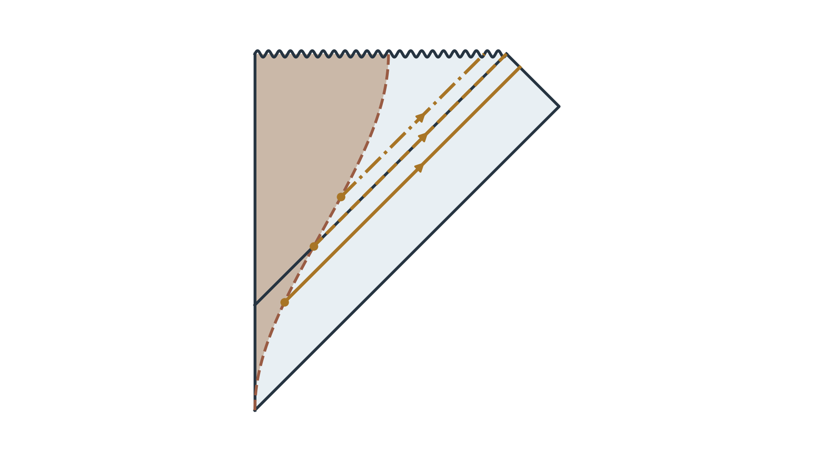
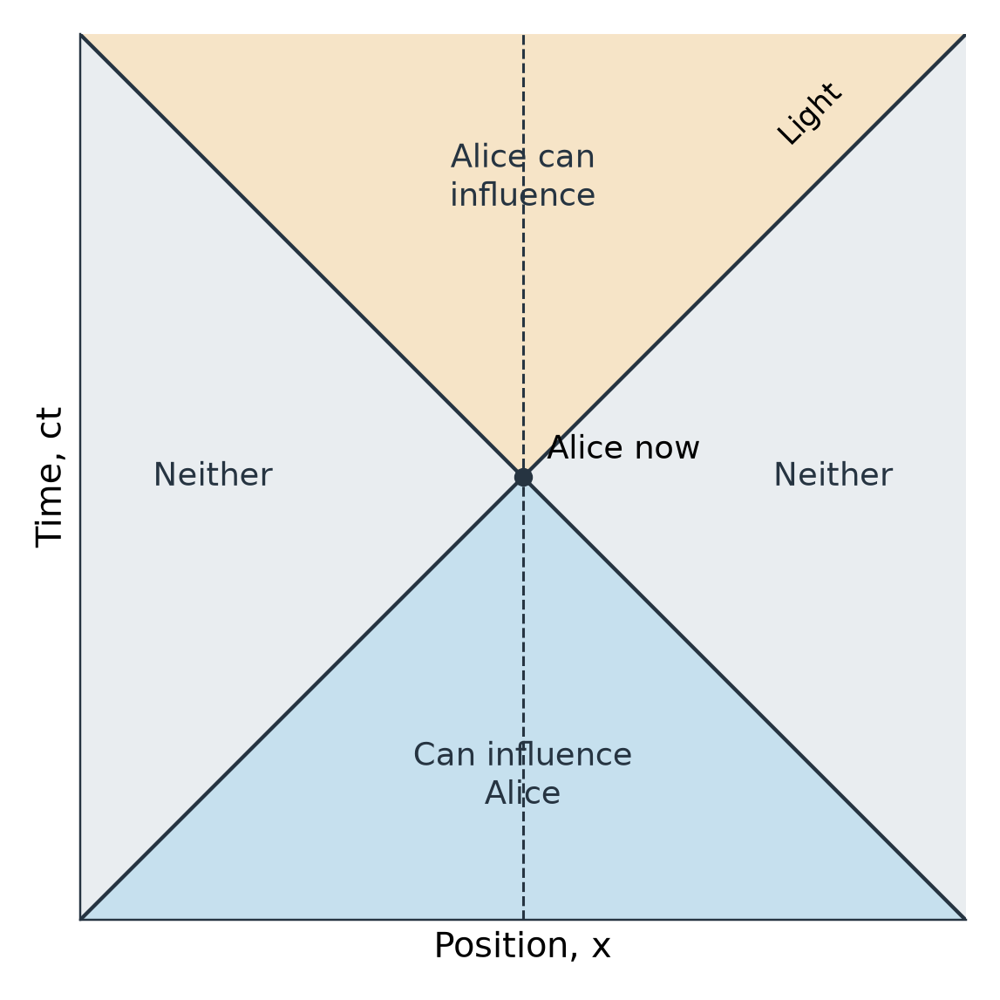
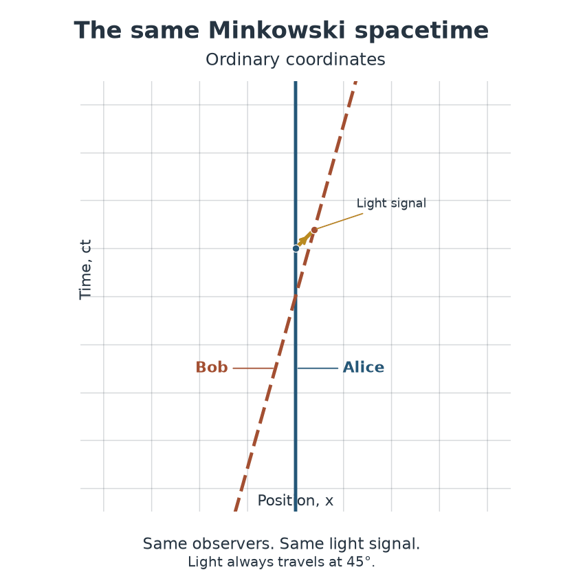
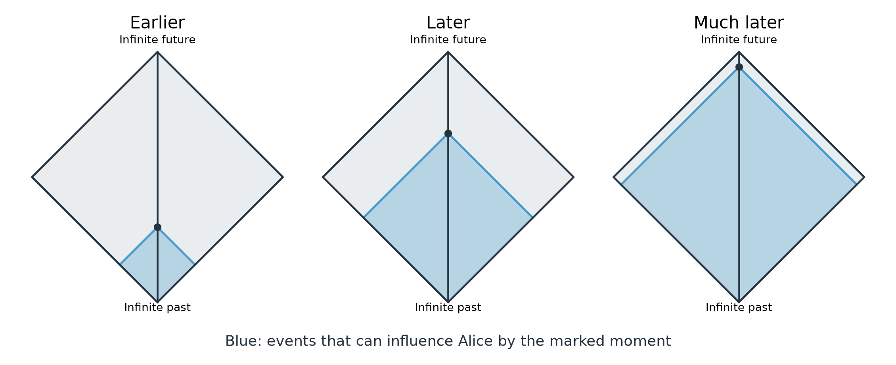
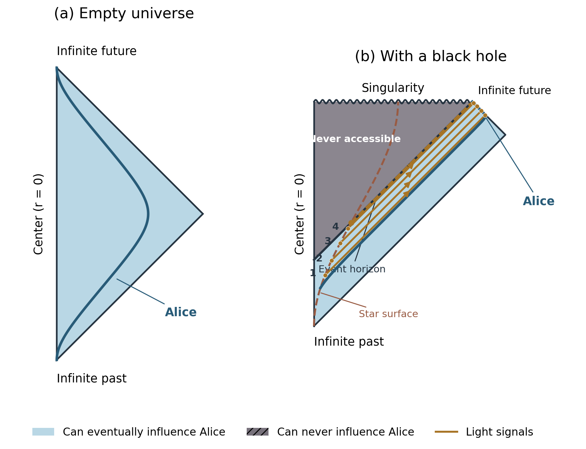

<!--
HOLOGRAPHY — POST 2 — MEDIUM PUBLISHING METADATA (not article prose)
Status: ARTICLE SKELETON / no body prose / not yet approved for publication
Revision: 2026-11-24 — figure-first structure

Medium title: A Black Hole Has Formed. Why Can’t We See It Happen?
Medium subtitle: Which parts of the universe can influence us, which parts can we influence, and how does a black hole change that?
Medium topics (choose up to five):
  - Black Holes
  - General Relativity
  - Physics
  - Spacetime
  - Astronomy
SEO title: Why Can’t We See a Black Hole Form? Penrose Diagrams Explained
SEO description: Follow light signals through spacetime and discover why some events remain invisible to a distant observer, however long they wait.
Suggested preview title: A Black Hole Has Formed. Why Can’t We See It Happen?
Suggested preview subtitle: How a black hole changes what we can ever observe
Publication: Science Spectrum (select at publishing time, if approved)
Canonical URL: [leave blank unless an earlier original is the canonical source]
Featured image: holography_post2_feature.png (TODO: not yet created)
Featured-image caption: TODO
Featured-image alt text: TODO
Suggested excerpt: Some events in the universe can influence us, while others are still beyond our reach. Penrose diagrams reveal how these regions change as we wait, and why a black hole places a permanent limit on what we can observe.

Asset notes:
- Figure 4 is the Minkowski morph animation (penrose_morph.gif, use the original 128-frame version, not the single-frame upload).
- Figure 5 is currently stored locally as figure_04.png; rename it to figure_05.png for this manuscript.
- The collapse morph is a companion to Figure 7, not a separately numbered figure.
- Figure 6: check the arrow direction in panel (a).
- Figure 7 and its companion animation: complete conformal-boundary and intermediate-frame review before publication.
- Figure 8: complete visual and scientific review; improve clipped label and verify Alice's worldline and signal intersections.
- Feature image is a placeholder only. Verify credits for all final assets.
- Use Unicode for all inline mathematical notation; no inline LaTeX.
- Verify source version, figure references and importer support for animated GIFs before publication.
-->

# A Black Hole Has Formed. Why Can’t We See It Happen?
## Which parts of the universe can influence us, which parts can we influence, and how does a black hole change that?

<!-- TODO: create and insert featured image.

> Caption: TODO
> Alt text: TODO
-->

## What Can Influence Us?

> Caption: **Figure 1.** Alice at a particular moment in spacetime. Events in the blue region can influence Alice, while Alice can influence events in the yellow region. Events in the gray regions cannot exchange a signal with Alice at the marked moment. The diagonal lines represent the paths of light.
> Alt text: Square position–time diagram with Alice at the center, a blue triangle below, a pale yellow triangle above, and gray triangles on either side. Diagonal light paths separate the four regions.

## How Do We Draw Infinity?

> Caption: **Figure 2.** An arctangent transformation maps an infinite coordinate range onto a finite interval. Applying the transformation separately to the two light coordinates compresses flat spacetime into a diamond while preserving the 45° direction of light rays. Based on [1].
> Alt text: Left, an arctangent curve approaching −1 and +1. Right, a diamond-shaped spacetime diagram containing curved lines of constant position and time.

## The Same Spacetime, Drawn Differently

> Caption: **Figure 3.** Alice remains at a fixed position while Bob moves to the right at constant velocity. Their paths look different in ordinary Minkowski coordinates and in the Penrose diagram, but the light signal connects exactly the same two events.
> Alt text: Two panels show Alice as a solid blue vertical line, Bob as a dashed rust-colored line, and a short gold light signal between them. Bob's straight path becomes curved in the diamond-shaped diagram on the right.

> Caption: **Figure 4.** Ordinary Minkowski coordinates gradually transform into a Penrose diagram. The grid and the observers’ paths change shape, but the light signal continues to connect the same events and retains its 45° direction.
> Alt text: Looping animation in which a rectangular spacetime grid compresses into a diamond, carrying Alice's and Bob's paths and their connecting light signal along with it.

## Can We Eventually See Everything?

> Caption: **Figure 5.** As Alice moves forward in time, more events can send signals that reach her. In empty, flat spacetime, every event can eventually influence an observer who remains at a fixed position. Based on [1].
> Alt text: Three Penrose diamonds marked Earlier, Later and Much later. A point moves upwards along Alice's vertical path, and the blue region below it expands until it nearly fills the diamond.

## From a Line to a Universe

> Caption: **Figure 6.** Three spherical shells are represented by their radii in ordinary spacetime and by corresponding curves in the Penrose diagram. A light ray passes through the center and continues outwards on the other side. Its change of direction in the radial diagrams reflects the use of the nonnegative radius r, not a physical reflection. Based on [1].
> Alt text: Three panels show numbered concentric spherical shells, three matching vertical lines in radial spacetime, and three matching curved lines inside a triangular Penrose diagram. A gold light path passes through the center.

## A Star Collapses

> Caption: **Figure 7.** Three outward-directed light signals leave the surface of an idealized collapsing star. Signal 1 escapes, signal 2 follows the event horizon, and signal 3 reaches the singularity. In radius–time coordinates the trajectories look different; in the Penrose diagram all three are parallel 45° lines. The collapse geometry follows the idealized classical picture discussed in [2].
> Alt text: Left, the radius of a collapsing star decreases with time. Three numbered light paths bend outwards, remain vertical at the horizon, or turn towards zero radius. Right, the corresponding Penrose diagram shows three diagonal gold paths, a dashed stellar surface, and a horizontal wavy singularity.

> Caption: **Figure 7 — Animation.** A visual transition between radius–time coordinates and the Penrose diagram of the collapsing star. The horizon becomes diagonal and the singularity becomes a horizontal future boundary. Intermediate frames are a visual transition, not necessarily conformal coordinates.
> Alt text: Animation transforming the collapsing star, its horizon, singularity and three light paths from a radius–time diagram into a compact Penrose diagram and back again.

## Infinity Is No Longer Enough

> Caption: **Figure 8.** Blue marks events that can eventually influence Alice. In an empty, flat universe, every event is accessible in this sense. With a black hole, the gray region remains inaccessible however long Alice waits. Successive outward light signals from the stellar surface reach Alice progressively later, but the limiting signal along the horizon never reaches her. Based on [2].
> Alt text: Two radial Penrose diagrams compare an entirely blue empty universe with a black-hole spacetime divided into blue and gray regions by a diagonal event horizon. Gold light signals connect the collapsing stellar surface to Alice's exterior path.

## A New Perspective on Horizons

<!-- Closing beat and next-post teaser: how much closer to the horizon was the light emitted each time Alice waits a little longer? No body prose yet. -->

## References

1. David Tong, *General Relativity* (2019), lecture notes, University of Cambridge. Chapter 3, §3.1.2 (Lorentzian manifolds); Chapter 4, §4.4.2 (Penrose diagrams); Chapter 6, §6.1 (Schwarzschild solution). https://www.damtp.cam.ac.uk/user/tong/gr.html
2. Edward Witten, *Introduction to Black Hole Thermodynamics*, arXiv:2412.16795 (2024 preprint; journal publication 2025), Section 3, Figures 1–2. https://arxiv.org/abs/2412.16795
