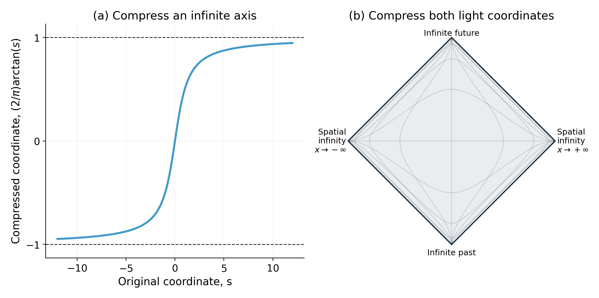
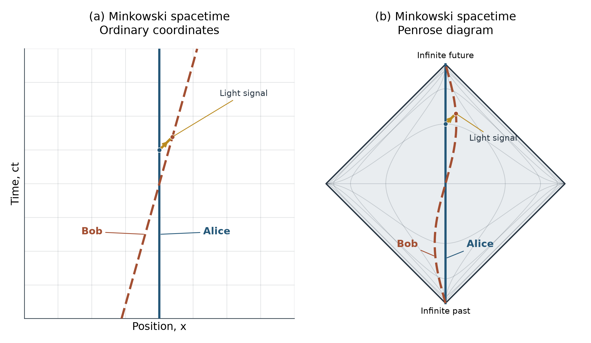
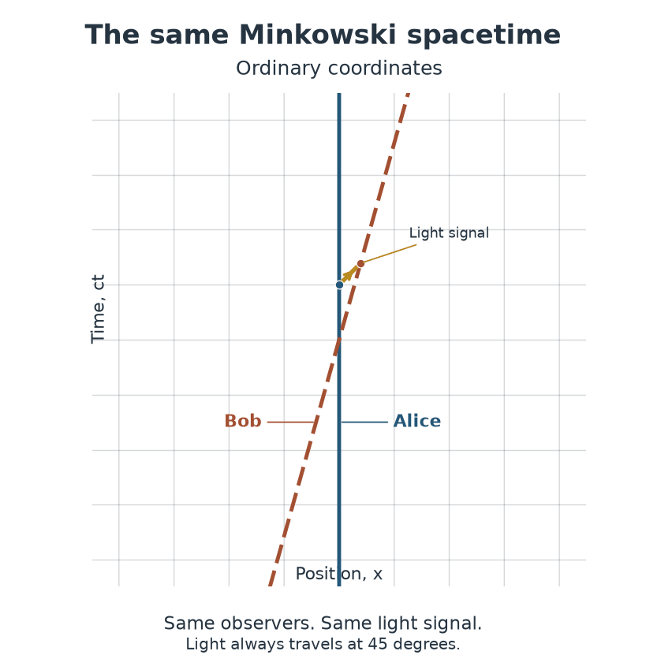
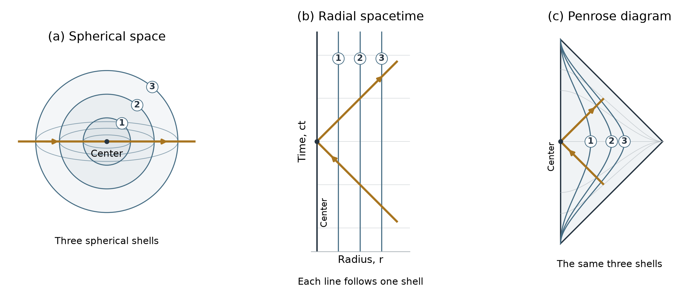
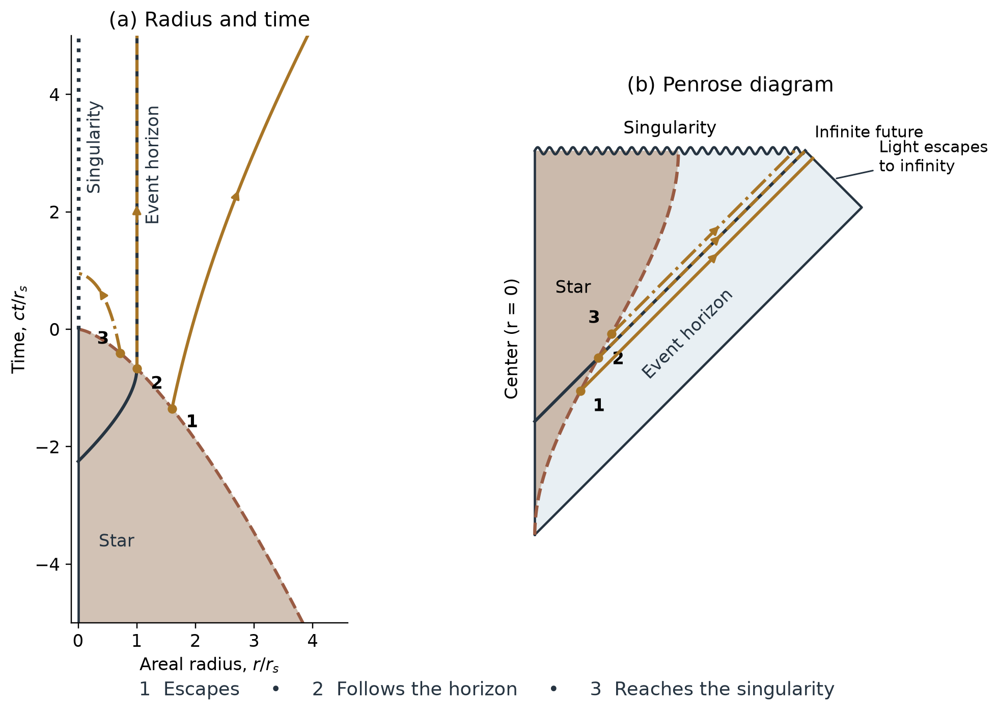
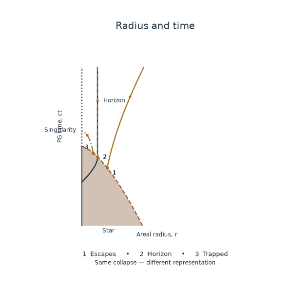
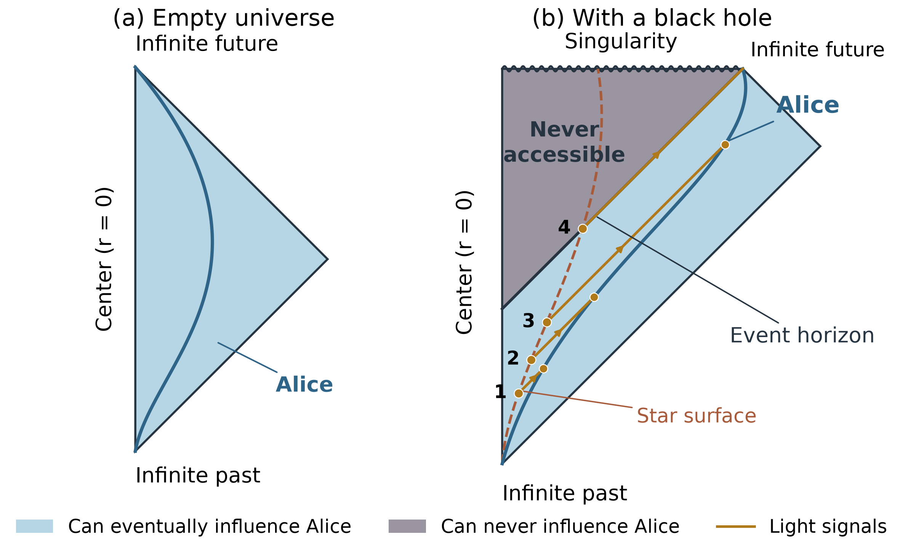

<!--
HOLOGRAPHY — POST 2 — MEDIUM PUBLISHING METADATA (not article prose)
Status: GATE B — final editorial manuscript / awaiting final author and asset approval
Revision: 2026-11-27 — final prose, captions, metadata and equation-formatting pass

Medium title: Can we see the birth of a black hole?
Medium subtitle: Light cannot escape a black hole, so what do we actually see when we look at one?
Medium topics (choose up to five):
  - Black Holes
  - General Relativity
  - Physics
  - Spacetime
  - Astronomy
SEO title: Why can’t we see a black hole form? Penrose diagrams explained
SEO description: Follow light signals through spacetime and discover why some events remain invisible to a distant observer, however long they wait.
Suggested preview title: Can we see the birth of a black hole?
Suggested preview subtitle: How a black hole changes what we can ever observe
Publication: Science Spectrum (select at publishing time, if approved)
Canonical URL: [leave blank unless an earlier original is the canonical source]
Featured image: holography_post2_feature.png
Featured-image caption: A collapsing star, seen through a Penrose diagram. Image by author.
Featured-image alt text: Penrose diagram of a collapsing star, showing the event horizon, singularity, and three gold light rays with different destinations.
Suggested excerpt: Some events in the universe can influence us, while others are still beyond our reach. Penrose diagrams reveal how these regions change as we wait, and why a black hole places a permanent limit on what we can observe.

Asset notes:
- Final numbering: Figures 1–9, including separately numbered animations 4 and 8. Do not renumber.
- Figure 4: figure_04_penrose_morph.gif. The latest uploaded copy has one frame; the recovered original has 128 frames and is included in the asset package.
- Figure 5: figure_05.png (three growing past regions).
- Figure 6: figure_06.png (three panels). Use the symmetric center-crossing version, generated by figure_06_updated.py supplied with this revision; panel (b) labels separated and panel (a) arrows checked.
- Figure 7: figure_07.png; calculated marginally bound homogeneous dust model in Painlevé–Gullstrand coordinates [3]. Pending final label-only revision: change the vertical axis from Infall time (PG) to Time, ct/rₛ. Keep the areal-radius axis, geometry and light trajectories unchanged. The caption defines areal radius and explains the time coordinate without introducing its technical name.
- Figure 8: figure_08_morph.gif (recovered 68-frame animation); figure_08_morph_final.png is the still supplied for review and may serve as a fallback, not a separately numbered figure. Intermediate frames are visual interpolations; the 45° light-ray convention need not hold until the final diagram.
- Figure 9: figure_09.png (latest supplied causal schematic). Do not describe its curves as calculated constant-radius trajectories or as the identical coordinate map of Figure 7. Signals 1–3 end on Alice; signal 4 follows the horizon without a reception marker. Final polish: move Never accessible label clear of the stellar surface and verify leader lines. Check consistency of null boundaries and worldlines before publication.
- Featured image completed: use the text-free calculated Penrose diagram. Confirm image credits and animated GIF handling in the importer before publication.
- Inline mathematics uses Unicode with italicized symbols; display equations use standalone $$ delimiters without grammatical punctuation inside the blocks. Retain punctuation with a mathematical function.

Editorial handoff:
- Classical general relativity; idealized spherical, nonrotating, non-evaporating collapse. Figure 7 uses the calculated dust model; Figure 9 is schematic. No claim of a quantitative constant-radius trajectory in Figure 9.
- Verified 2026-11-26: Tong’s current HTML §4.4.2 (Penrose diagrams) and §§6.1.4–6.1.5 (event horizon and collapse); Witten arXiv:2412.16795v5 HTML §3, Figs. 1–2, logarithmic reception-time relation and exponential inverse (numbered (7)–(8) in the served HTML; PDF numbering not verified). Reference [2] identifies the equations by subject instead of number. Reference [3] journal bibliographic details verified; its full text was not re-reviewed in this pass.
- Gate B: final manuscript edited on 2026-11-27. No image files or animations changed or revalidated in this pass; Figure 7 label update is pending. Confirm final Figure 9 geometry and visual polish, animation files and importer behavior before publication. Reference verification status above is carried forward from the earlier review, not a new external check.
-->

# Can we see the birth of a black hole?
## Light cannot escape a black hole, so what do we actually see when we look at one?

> Caption: A collapsing star, seen through a Penrose diagram. Image by author.
> Alt text: Penrose diagram of a collapsing star, showing the event horizon, singularity, and three gold light rays with different destinations.
> Source: Image by author.

We all know that no light can reach a distant observer from the event horizon of a black hole or from anywhere inside it. But what does an observer, Alice, actually see when she looks at a black hole? Let's ignore the light emitted by the surrounding matter and focus on the star that collapsed to form it.

Is Alice looking back in time, still seeing the collapsing star? Will she eventually see its surface cross the horizon? Or does she see nothing at all?

The question goes beyond what Alice can see. If no light can reach her from a region of spacetime, neither can any other physical signal. Can there be events in our universe that will never influence us, however long we wait?

## What can influence us?

Let's first step away from the black hole and consider a universe with flat spacetime. At any given moment, some events can influence Alice and others cannot. We can draw these regions in a spacetime diagram. We consider one spatial dimension, with position *x* on the horizontal axis. On the vertical axis we plot time *t* multiplied by the speed of light *c*. Both axes now have units of length, and with equal scales on the two axes, light follows lines at 45°.

The point in the middle of Figure 1 represents Alice at one particular moment. Such a point is called an event: it specifies both a position and a time. The dashed vertical line is Alice’s worldline, the succession of events that describes her life at a fixed position.

The two diagonal lines divide spacetime into four regions. An event in the blue region can send a signal that reaches Alice by the marked moment. The yellow region contains events that she can influence from that moment onwards. Exchanging a signal between Alice now and an event in either gray region would require faster-than-light communication. The blue and yellow regions, including their diagonal boundaries, make up her past and future light cones.

> Caption: **Figure 1.** Alice at a particular moment in spacetime. Events in the blue region can influence Alice, while Alice can influence events in the yellow region. Events in the gray regions cannot exchange a signal with Alice at the marked moment. The diagonal lines represent the paths of light.
> Alt text: Square position–time diagram with Alice at the center, a blue triangle below, a pale yellow triangle above, and gray triangles on either side. Diagonal light paths separate the four regions.
> Source: Image by author.

Figure 1 covers only a finite range of positions and times. Can we extend the diagram to include all of spacetime while preserving the relationships between events?

## How do we draw an infinite spacetime?

We want to map infinite distances and times onto a finite diagram while preserving the 45° direction of light rays. The arctangent does exactly this. For a dimensionless variable *s*, we use the normalized form

$$
f(s)=\frac{2}{\pi}\arctan(s)
$$

As *s* increases, *f(s)* approaches +1; for increasingly negative values of *s*, it approaches −1 (Figure 2a). Neither limit is reached for any finite *s*.

Applying this function separately to position and time would compress the diagram, but light paths would no longer be straight lines at 45°. To preserve the direction of the light rays, we use two coordinates that are directly related to the paths of light. We define

$$
u=\frac{ct-x}{L}\qquad v=\frac{ct+x}{L}
$$

where *L* is an arbitrary reference length that makes *u* and *v* dimensionless. For light travelling to the right, *x* increases at the same rate as *ct*, so *u* remains constant. For light travelling to the left, *v* remains constant.

We compress *u* and *v* into new light coordinates *U* and *V*. Their sum and difference give us the new vertical coordinate *T* and horizontal coordinate *X*:

$$
\begin{aligned}
U&=f(u)\qquad V=f(v)\\[4pt]
T&=\frac{V+U}{2}\qquad X=\frac{V-U}{2}
\end{aligned}
$$

For light travelling to the right, *T* − *X* is constant; for light travelling to the left, *T* + *X* is constant. Both directions are still at 45°. Along any future-directed physical path, neither light coordinate can decrease. Compressing them with a strictly increasing function preserves this condition. The result is the diamond in Figure 2b, a **Penrose diagram** of flat spacetime [1].

> Caption: **Figure 2.** The normalized arctangent compresses the real line into the open interval from −1 to +1. Applying this compression separately to the two light coordinates produces a diamond while preserving the 45° direction of light rays. The left and right corners represent spatial infinity, not infinite time. Based on [1].
> Alt text: Left, a normalized arctangent curve approaching −1 and +1. Right, a diamond-shaped spacetime diagram with curved coordinate lines, infinite past and future at the bottom and top, and spatial infinity at the left and right corners.
> Source: Image by author.

The four corners have different meanings. At the top and bottom, time goes to plus or minus infinity at fixed position. The left and right corners represent spatial infinity, for example when we let *x* tend to −∞ or +∞ at a fixed time. A future-directed light ray travelling forever approaches one of the upper diagonal edges instead. These edges represent limits, not places where the light encounters a wall.

## The same spacetime, drawn differently

Suppose Bob moves to the right at a constant velocity relative to Alice. Alice sends him a light signal. Figure 3 shows its emission and reception in the ordinary coordinates of special relativity (Minkowski spacetime) and in the Penrose diagram of the same spacetime.

> Caption: **Figure 3.** Alice remains at a fixed position while Bob moves to the right at constant velocity. Their paths look different in ordinary Minkowski coordinates and in the Penrose diagram, but the light signal connects exactly the same two events.
> Alt text: Two panels show Alice as a solid blue vertical line, Bob as a dashed rust-colored line, and a short gold light signal between them. Bob's straight path becomes curved in the diamond-shaped diagram on the right.
> Source: Image by author.

Bob’s worldline has become curved in the Penrose diagram, but he is still moving at the same constant velocity relative to Alice. Neither physical distances nor time intervals can be read directly from the new diagram.

The light signal, however, still connects the same two events at 45°. We can see this throughout the transformation in Figure 4.

> Caption: **Figure 4.** Ordinary Minkowski coordinates gradually transform into a Penrose diagram. The grid and the observers’ paths change shape, but the light signal continues to connect the same events and retains its 45° direction.
> Alt text: Looping animation in which a rectangular spacetime grid compresses into a diamond, carrying Alice's and Bob's paths and their connecting light signal along with it.
> Source: Image by author.

In the Penrose diagram, a future-directed physical signal can only travel upwards, at no more than 45° from the vertical. The tangent to the worldline of a massive observer must lie strictly between these two directions.

## Can we eventually see everything?

Alice waits at a fixed position in Minkowski spacetime. At three successive moments we draw her past light cone (Figure 5).

> Caption: **Figure 5.** The blue region is Alice’s accessible past at three successive times. For an observer at a fixed position in Minkowski spacetime, every finite event is eventually included. Based on [1].
> Alt text: Three Penrose diamonds marked Earlier, Later and Much later. A point moves upwards along Alice's vertical path, and the blue region below it expands until it nearly fills the diamond.
> Source: Image by author.

The blue region covers more and more of the diamond. For any event at a finite position and time, a light signal can reach Alice in a finite time. She does not need to reach the point labelled Infinite future to receive it.

> **There is no region of this universe that is permanently inaccessible to Alice. The events she cannot yet observe simply require more time.**

Now let's go back to the black hole. Can Alice still eventually see all of spacetime?

## From position to radius

A collapsing star is a three-dimensional object. But if we assume spherical symmetry, we only need to retain the radial coordinate *r*. On a spacetime diagram with *ct* vertical and *r* horizontal, a point at nonzero radius represents an entire spherical surface at a particular time.

Figure 6a shows three such spherical surfaces. If they remain at fixed radii, they become the three vertical lines in Figure 6b. In this flat spacetime example, applying the same transformation as before, with *r* in place of *x*, gives us the three curved lines in Figure 6c.

> Caption: **Figure 6.** Three spherical shells are represented by their radii in ordinary spacetime and by corresponding curves in the Penrose diagram. A light ray passes through the center and continues outwards on the other side. Its change of direction in the radial diagrams reflects the use of the nonnegative radius *r*, not a physical reflection. Based on [1].
> Alt text: Three panels show numbered concentric spherical shells, three matching vertical lines in radial spacetime, and three matching curved lines inside a triangular Penrose diagram. A gold light path passes through the center.
> Source: Image by author.

The diamond has become a triangle because *r* cannot be negative. The vertical line on the left is the center, not an edge of the physical universe. A light ray travelling straight through the center first moves to smaller radii and then to larger radii. Its path in the radial diagrams changes from an upward-left to an upward-right diagonal, although the light itself has not reflected.

## A star collapses

Suppose we put a star in this universe and let it collapse under its own gravity. Our model is a nonrotating, homogeneous sphere of pressureless matter, collapsing from rest at infinity [3]. We use classical general relativity and neglect evaporation.

Figure 7a shows the radius of the stellar surface (the dashed brown line) decreasing with time. We express the radius in units of the Schwarzschild radius *rₛ*, which depends on the mass *M* of the star:

$$
r_s=\frac{2GM}{c^2}
$$

Here *G* is Newton’s gravitational constant. We use a time coordinate that allows us to follow the collapse through *r* = *rₛ* [3].

What happens to light emitted from the stellar surface before, at and after it passes this radius?

In the vacuum outside the stellar material, the radial coordinate velocity of outward-directed light in these coordinates is

$$
\frac{dr}{dt}=c\left(1-\sqrt{\frac{r_s}{r}}\right)
$$

Consider the three signals in Figure 7a. The first leaves the star while its radius is still larger than *rₛ*. The radial coordinate velocity is positive, and the light travels to larger radii. For the second signal, emitted at *r* = *rₛ*, the radial coordinate velocity is zero. The third signal is also directed outwards, but because the radius of the star is now smaller than *rₛ*, its radial coordinate velocity is negative. It travels towards smaller radii until it encounters the singularity.

> Caption: **Figure 7.** Three outward-directed light signals leave the surface of an idealized collapsing star. Signal 1 escapes, signal 2 follows the event horizon, and signal 3 reaches the singularity. Panel (a) uses areal radius *r* (defined such that a sphere has area *A* = 4π*r*²) and a time coordinate that remains regular at the horizon. Panel (b) shows the same collapse in Penrose coordinates, where all three signals follow parallel 45° lines. Calculated for a homogeneous pressureless collapse model [3], with the diagram guided by [2].
> Alt text: Left, the radius of a collapsing star decreases with time. Three numbered light paths bend outwards, remain vertical at the horizon, or turn towards zero radius. Right, the corresponding Penrose diagram shows three diagonal gold paths, a dashed stellar surface, and a horizontal wavy singularity.
> Source: Image by author.

All three signals are emitted radially outwards in the local frame of the collapsing surface, and all travel locally at the speed of light. The sign of the coordinate velocity tells us whether the areal radius increases or decreases, not how fast light passes a local observer. In Figure 7b the three light paths become parallel lines at 45°. Signal 1 reaches the upper-right boundary, which represents light escaping to infinity. Signal 2 follows the diagonal line that separates light paths that can escape from those that cannot. Signal 3 ends at the wavy line.

In Figure 7a, the singularity appears to be located at the center of the black hole. The Penrose diagram in Figure 7b reveals something quite different. Inside the black hole, the singularity is no longer a place in space that we can choose to avoid. It lies in the future of anything strictly inside the horizon.

> **Once inside the black hole, reaching the singularity is as unavoidable as moving forward in time.**

The diagonal line separating the black hole region from the exterior is the **event horizon**. It starts at the center of the star. Part of the star is already inside the horizon before the surface crosses it. The horizon is not a material barrier that stops light. Its location is determined by where light can eventually go in the entire spacetime [1].

> Caption: **Figure 8.** A visual transition between the areal-radius and time representation of Figure 7 and its Penrose diagram. The constant-radius part of the horizon becomes diagonal, and the singularity becomes a horizontal future boundary. The intermediate frames illustrate the transition; light rays need not be at 45° until the final diagram.
> Alt text: Animation transforming the collapsing star, its horizon, singularity and three light paths from a radius–time diagram into a compact Penrose diagram and back again.
> Source: Image by author.

## Infinity is no longer enough

Let Alice observe the collapsing star from a fixed, large radius, outside the stellar surface during the observations we consider. We give her as much time as she needs and ask which events can ever send a signal that reaches her.

Figure 9 compares the answer with the one we found for flat spacetime. The left panel is the limit of the process shown in Figure 5, now drawn using radial coordinates. As Alice continues along her worldline towards the top of the diagram, every finite event will eventually lie in the blue region. In the right panel, Alice remains outside the black hole and her worldline approaches the upper endpoint of the horizon as her time tends to infinity. There is now a region of spacetime from which she can never receive a signal: the interior of the black hole.

We can see why by picking an event in the gray region and drawing a light ray towards the right. The ray ends at the singularity, without crossing the horizon. Any other future-directed physical signal is confined to directions between the two radial light paths, so it cannot escape either. Alice can still send signals into the black hole, but no signal can return from inside it.

> Caption: **Figure 9.** Blue marks events that can eventually influence Alice. In empty Minkowski spacetime, an observer remaining at a fixed position can eventually receive a signal from any finite event. With a black hole, the gray region remains inaccessible to Alice, however long she waits outside the horizon. Signals 1–3 reach Alice at successively later moments; signal 4 is emitted at horizon crossing and follows the horizon without ever reaching her. Schematic causal diagrams guided by [1,2].
> Alt text: Two radial Penrose diagrams compare an entirely blue empty universe with a black-hole spacetime divided into blue and gray regions by a diagonal event horizon. Alice follows a blue curve in each panel. In the right panel, the dashed stellar surface extends to the singularity. Three gold signals end on Alice’s path; a fourth follows the horizon without an arrival dot.
> Source: Image by author.

## What does Alice see?

In Figure 9 we have also drawn four light signals emitted from the stellar surface. The first three reach Alice. The fourth (signal 2 in Figure 7) is emitted precisely when the stellar surface crosses the horizon and never reaches her. Nor can Alice see the event at which the horizon first forms at the center of the star: an outgoing light ray from that event follows the horizon itself.

For a distant observer at a fixed radius, the closer the emission is to horizon crossing, the longer the signal takes to arrive. Near the horizon, the outgoing radial coordinate velocity in Figure 7a is proportional to *r* − *rₛ*. Integrating the inverse of this velocity over radius gives a travel time that grows without bound as the emission radius approaches *rₛ*.

So, the longer Alice waits, the closer to the horizon the stellar surface was when it emitted the light she receives.

Does this mean Alice will forever see the collapsing star approaching its horizon? In principle, if the surface continues to emit light up to horizon crossing, light emitted ever closer to the horizon can reach Alice at arbitrarily late times. But this light is increasingly redshifted and faint [2]. Instead of seeing a bright image of the star frozen at the horizon, Alice sees the stellar surface fade below the sensitivity of her detector.

There is a difference between knowing that a black hole has formed and observing the stellar surface cross its horizon. Alice can infer the former from observations outside the horizon and a model of the collapse, but not even a perfect telescope will allow her to see the crossing.

**No matter how long Alice waits, she will never see the star cross its horizon.**

In the next post, we will see how the relation between emission and reception time connects the geometry of spacetime to the quantum physics of black holes [2].

Let me know what you think in the comments, and subscribe if you would like to follow the next step in our exploration.

## References

1. David Tong, *General Relativity* (2019), lecture notes, University of Cambridge. Section 4.4.2 (Penrose diagrams) and Sections 6.1.4–6.1.5 (Kruskal spacetime and black hole formation). https://davidtong.org/teaching/general-relativity/

2. Edward Witten, *Introduction to Black Hole Thermodynamics*, arXiv:2412.16795v5 (first posted 2024; version 5, 22 July 2026), Section 3, Figures 1–2 and the logarithmic reception-time relation and its exponential inverse. https://arxiv.org/html/2412.16795v5

3. Y. Kanai, M. Siino and A. Hosoya, *Gravitational Collapse in Painlevé–Gullstrand Coordinates*, Progress of Theoretical Physics **125**, 1053–1065 (2011). https://doi.org/10.1143/PTP.125.1053
